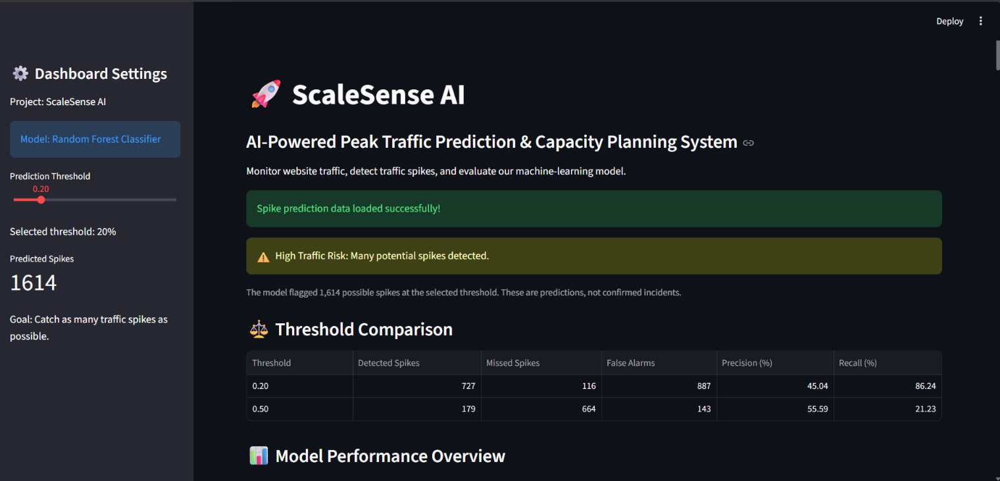
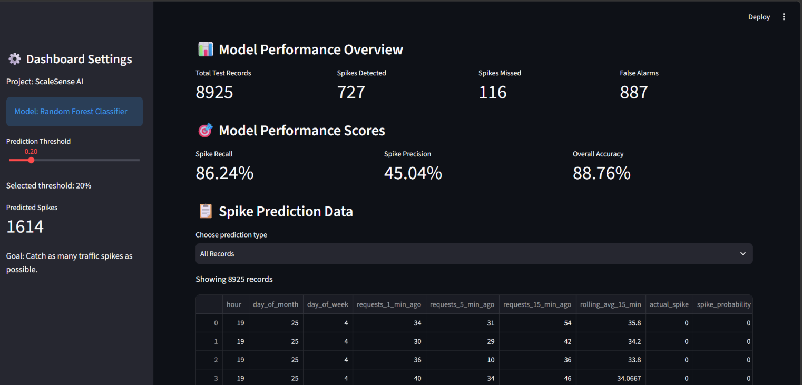
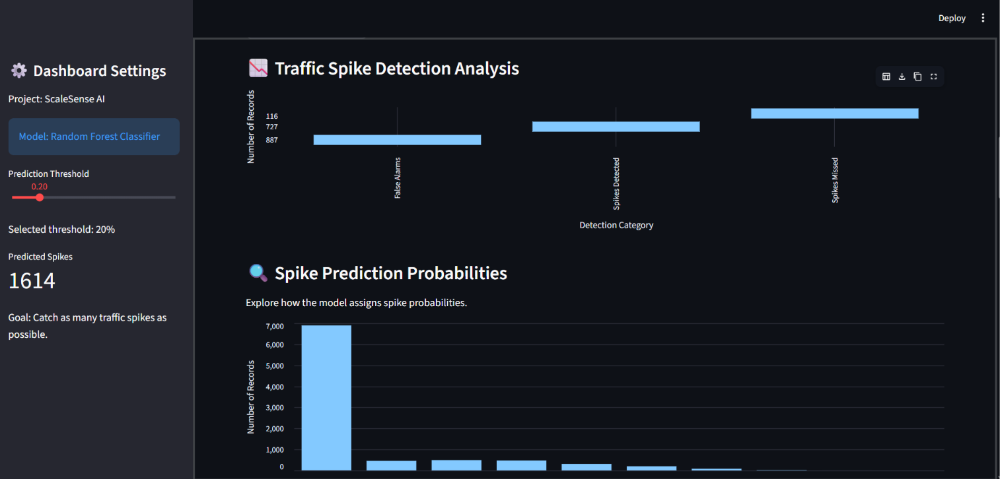
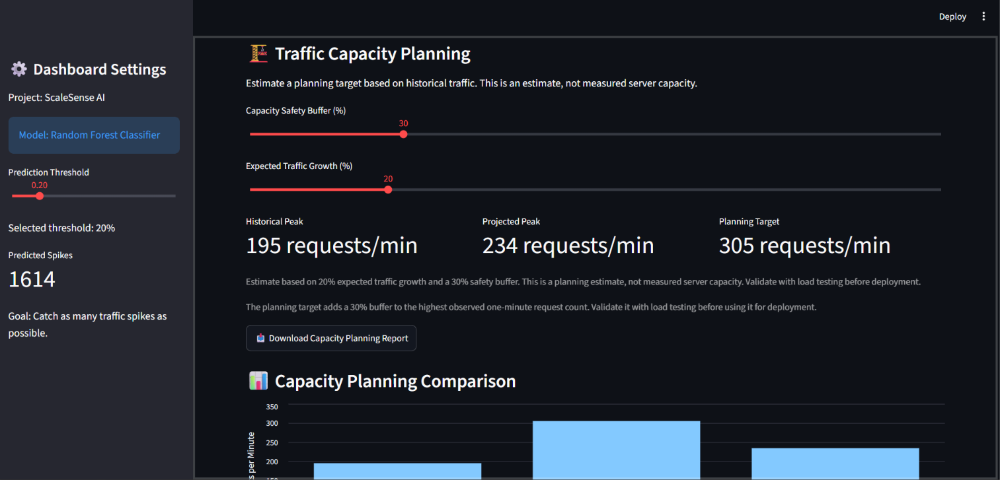
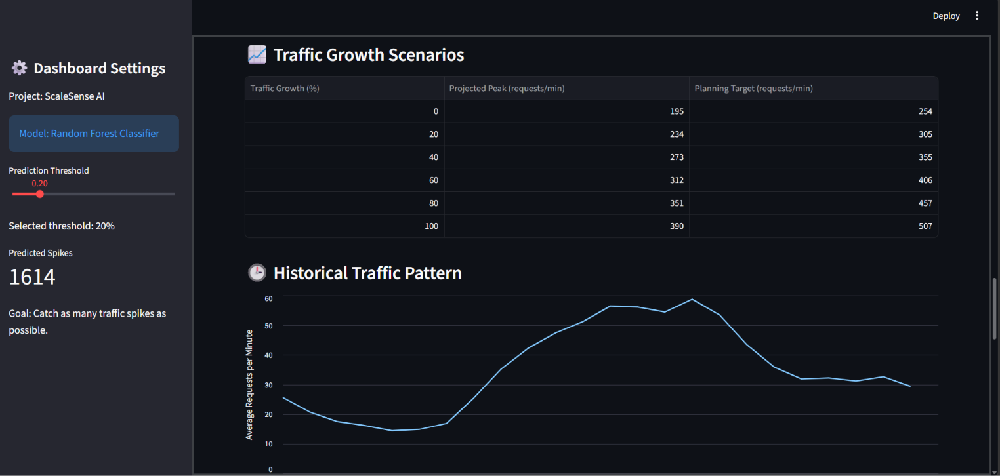
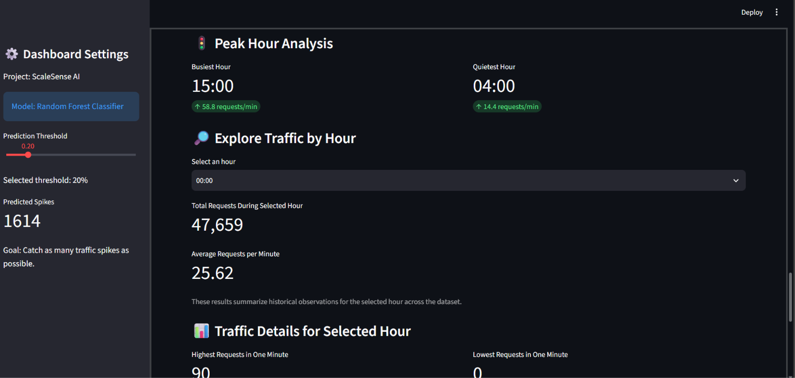
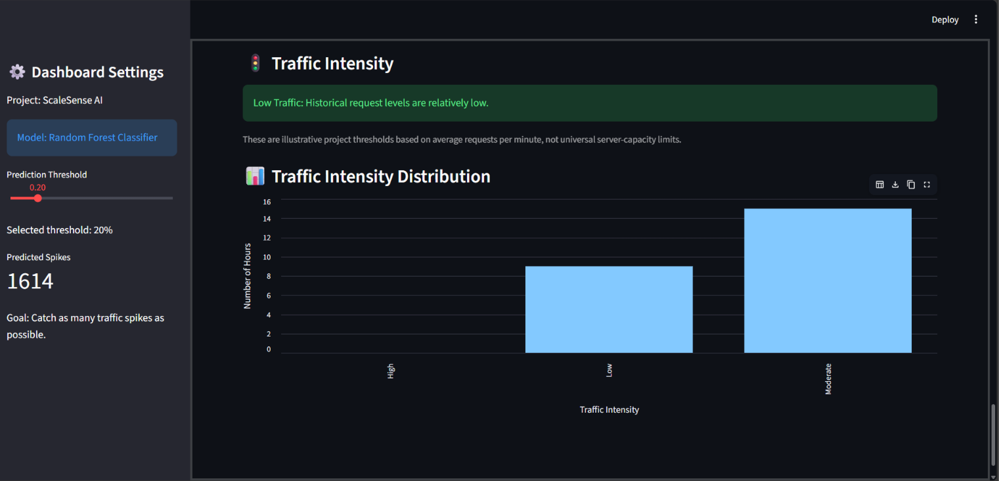

# ScaleSense AI — AI-Powered Traffic Prediction & Capacity Planning

ScaleSense AI is a data analytics and machine learning project that analyzes historical web traffic, predicts traffic patterns, identifies potential traffic spikes, and estimates future capacity needs under different growth scenarios.

## Project Objectives

- Analyze historical web server traffic.
- Predict request volumes using machine learning.
- Identify potential high-traffic periods.
- Evaluate spike detection using precision, recall, and confusion matrices.
- Estimate capacity requirements under different traffic growth scenarios.
- Visualize traffic insights using Python, SQL, Power BI, and Streamlit.

## Technologies Used

- **Python:** Data cleaning, analysis, and machine learning
- **Pandas:** Data processing
- **Scikit-learn:** Random Forest regression and classification
- **Matplotlib:** Data visualization
- **MySQL:** Traffic analysis and SQL views
- **Power BI:** Interactive analytics dashboard
- **Streamlit:** Interactive machine learning and capacity planning dashboard
- **VS Code:** Development environment

## Dataset

The project uses historical NASA HTTP web server access logs from August 1995.

The raw logs were parsed and transformed into minute-level traffic records.

- Parsed HTTP log records: approximately 1.57 million
- Minute-level records: 44,640
- Missing timestamps: 0
- Missing response sizes: 13,998

**Important:** This dataset contains historical web request traffic. It does not contain actual CPU utilization, memory utilization, or server capacity measurements. Capacity estimates therefore use traffic-based assumptions rather than measured infrastructure utilization.

## Machine Learning

### 1. Traffic Prediction

A Random Forest regression model forecasts request volume using time-related features and historical traffic patterns.

Evaluation metrics:
- Mean Absolute Error (MAE)
- Root Mean Squared Error (RMSE)

Current evaluation:
- MAE: approximately 10.87 requests per minute
- RMSE: approximately 14.54 requests per minute

### 2. Traffic Spike Detection

A Random Forest classifier estimates whether the next minute will exceed the high-traffic threshold.

The spike threshold is based on the 95th percentile of historical request counts.

Current evaluation at a probability threshold of 0.20:
- Accuracy: approximately 88.76%
- Precision: approximately 45.04%
- Recall: approximately 86.24%
- F1-score: approximately 0.59
- Average precision: 0.508

The selected threshold prioritizes catching potential spikes, accepting more false alarms in return. These results are an initial evaluation and should not be interpreted as production performance guarantees.

## SQL Analytics

MySQL is used to calculate:
- Daily traffic summaries
- Hourly traffic summaries
- Peak requests per minute
- Average requests per minute
- High-traffic minute counts
- High-traffic percentages by hour

Database: `scalesense_ai`

Main table: `traffic_data`

## Dashboards

### Power BI
The Power BI dashboard provides:
- Total request volume
- Peak traffic per minute
- Average traffic by hour
- High-traffic minutes by hour
- Daily traffic comparisons
- Hourly traffic risk summaries

### Streamlit
The Streamlit application provides:
- Interactive spike-detection threshold selection
- Spike detection metrics
- Prediction category filters
- Prediction CSV download
- Historical traffic exploration
- Capacity estimates under different growth scenarios

Capacity estimates are illustrative planning scenarios based on historical traffic and configurable growth and safety assumptions.

## Project Structure

```text
ScaleSense_AI/
├── data/
│   ├── nasa_traffic_cleaned.csv.gz
│   ├── traffic_ml_dataset.csv.gz
│   ├── traffic_predictions.csv
│   ├── spike_ml_dataset.csv
│   ├── spike_predictions.csv
│   └── scalesense_traffic_sql.csv
├── dashboards/
│   ├── actual_vs_predicted.png
│   ├── average_traffic_by_hour.png
│   ├── spike_detection_summary.png
│   └── spike_dashboard_kpis.png
├── notebooks/
│   ├── 01_inspect_data.py
│   ├── 07_train_spike_model.py
│   └── ...
├── app.py
├── ScaleSense_AI_Dashboard.pbix
└── README.md
```

*Note: This structure highlights the main project files. Update filenames if your actual folder structure differs.*

## How to Run the Streamlit App

1. Install Python.
2. Open a terminal in the project directory.
3. Install the required packages:

```bash
pip install pandas scikit-learn matplotlib streamlit
```

4. Start the application:

```bash
python -m streamlit run app.py
```

## Future Improvements

- Improve peak-traffic forecasting.
- Reduce false-positive spike alerts.
- Test additional forecasting and classification models.
- Incorporate real infrastructure metrics such as CPU and memory utilization.
- Deploy the dashboard for public demonstration.

## Project Disclaimer

This is a portfolio and learning project based on historical web traffic. Spike alerts indicate statistically high traffic, not confirmed outages or incidents. Capacity estimates are illustrative and are not substitutes for infrastructure monitoring or load testing.

## Author

**Manoj Kumar**  
Aspiring Data Analyst | Aspiring Data Scientist

## 📸 Dashboard Screenshots

Explore the complete ScaleSense AI dashboard from top to bottom.

### Dashboard Overview — Part 1


### Dashboard Overview — Part 2


### Dashboard Overview — Part 3


### Dashboard Overview — Part 4


### Dashboard Overview — Part 5


### Dashboard Overview — Part 6


### Dashboard Overview — Part 7

