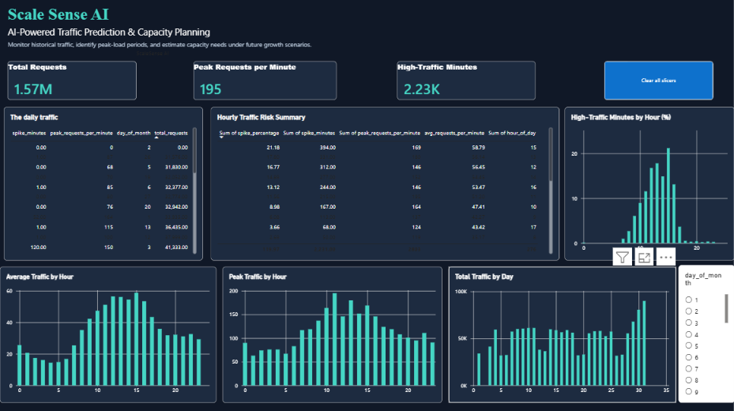
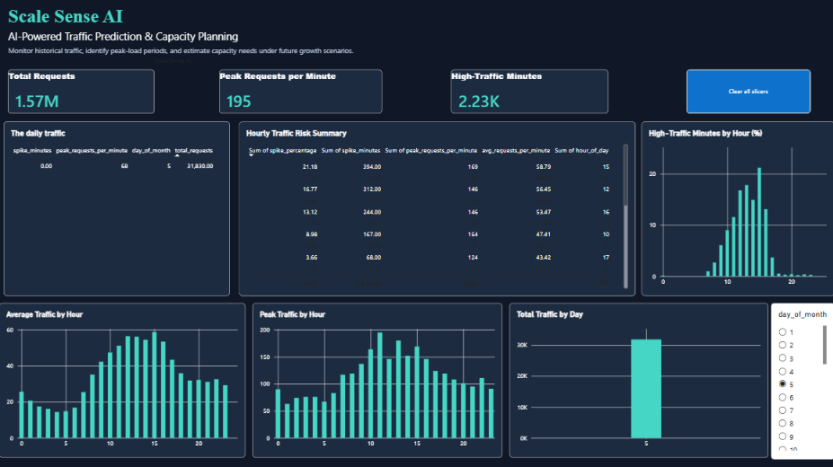

# ScaleSense AI — MySQL Analytics

## Overview
This folder contains SQL queries for analyzing historical NASA web server traffic. The analysis identifies daily and hourly traffic patterns, peak request volumes, and statistically defined high-traffic periods.

## Database
- **Database:** `scalesense_ai`
- **Main table:** `traffic_data`

### Key columns
| Column | Description |
|---|---|
| `timestamp_value` | Timestamp of the traffic record |
| `request_count` | Number of requests in the recorded minute |
| `hour_of_day` | Hour of the day (0–23) |
| `day_of_month` | Day of the month |
| `day_of_week` | Day of the week |

## SQL Analysis
The file `scalesense_analysis.sql` includes four analytical queries:

1. **Daily traffic summary:** Total requests, average requests per minute, and daily peak traffic.
2. **Hourly traffic summary:** Compares traffic across the 24 hours of the day.
3. **High-traffic analysis:** Counts minutes exceeding the historical threshold of 84 requests per minute.
4. **Power BI summary:** Calculates hourly request totals, averages, peaks, high-traffic minutes, and spike percentages.

## How to Run
1. Open MySQL Workbench and connect to your MySQL server.
2. Confirm that the `scalesense_ai` database and `traffic_data` table exist.
3. Open `scalesense_analysis.sql`.
4. Execute the queries individually or run the complete script.

## Important Note
The threshold of 84 requests per minute is based on the historical dataset's 95th percentile. It is a statistical traffic indicator, not proof of a real server outage or capacity failure.

## Technology
- MySQL
- MySQL Workbench
- Power BI
- Python and Streamlit (for the broader project)

### Power BI Dashboard Preview

**Dashboard — Overview**

**Dashboard — Additional Analytics**

